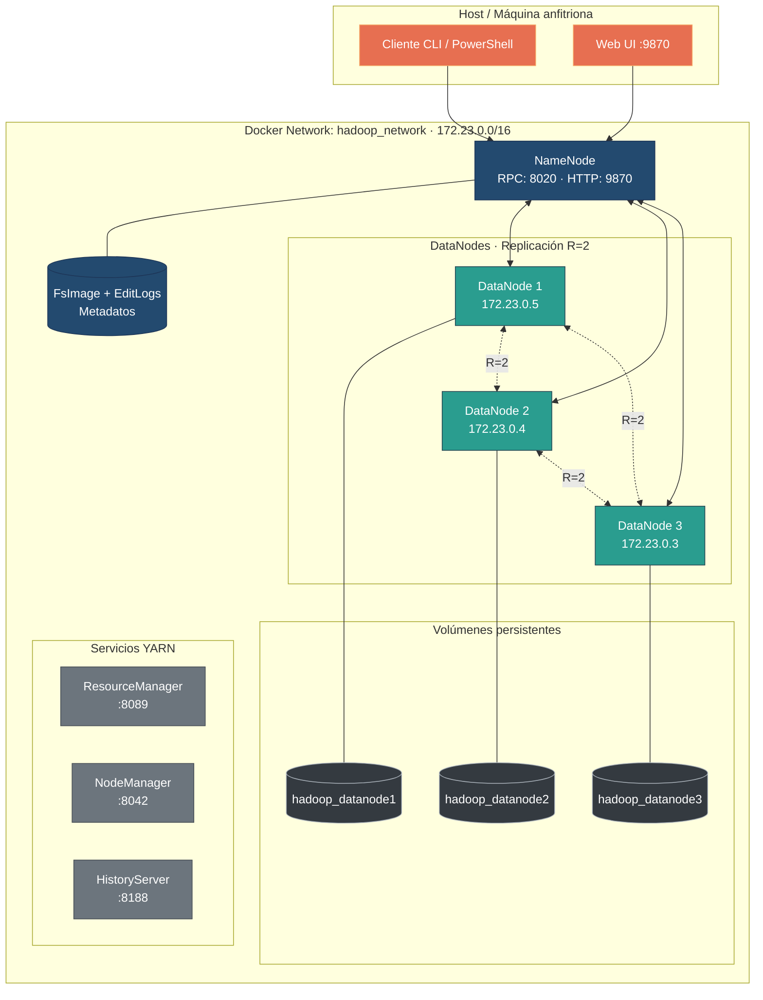

# bigdata-hdfs-grupo4

# Tolerancia a fallos y replicación de datos en HDFS
**Universidad del Valle - Sistemas Distribuidos y Big Data**  
**Grupo 04**

---

## Introducción

En los entornos de procesamiento masivo de datos (Big Data), el almacenamiento persistente y confiable de la información constituye uno de los desafíos arquitectónicos más críticos. Las soluciones tradicionales basadas en servidores propietarios y hardware tolerante a fallos de alta gama resultan económicamente inviables a escala de múltiples petabytes. Por esta razón, el sistema de archivos distribuido de Apache Hadoop (**Hadoop Distributed File System - HDFS**) fue diseñado desde su origen bajo el principio rector de que **las fallas de componentes físicos son la norma y no la excepción** en clústeres a gran escala conformados por hardware estándar (*commodity hardware*).

Para garantizar la disponibilidad ininterrumpida y la integridad de los datos ante eventos de falla sin requerir intervención manual constante, HDFS desacopla la arquitectura en dos componentes principales:
1. **NameNode (Maestro):** Administrador exclusivo del espacio de nombres (*namespace*) del sistema de archivos y gestor de metadatos (ubicación y correspondencia de bloques a nodos).
2. **DataNodes (Esclavos):** Servidores encargados de almacenar físicamente en disco los bloques de datos (particionados en tamaños de 128 MB) y de transferir bloques entre sí.

La tolerancia a fallos en HDFS se sustenta en la **replicación activa de bloques** y en un estricto protocolo de supervisión periódica por señales de vida (*heartbeats*) y reportes de bloques (*block reports*). El presente trabajo documenta la implementación, configuración y validación experimental de un clúster HDFS de 4 nodos (1 NameNode y 3 DataNodes) con factor de replicación $R=2$, sometido a pruebas controladas de caída de DataNodes ante datasets de 1 GB y 10 GB, registrando empíricamente la detección de nodos caídos, la disponibilidad continua del archivo y la autorrecuperación (*self-healing*) de réplicas subreplicadas hacia los nodos supervivientes.

---

## 1. Objetivo

El objetivo principal de esta práctica es implementar y validar experimentalmente un entorno distribuido de almacenamiento mediante **Apache Hadoop HDFS** compuesto por **1 NameNode y 3 DataNodes**, configurando un **factor de replicación mínimo de 2** (`dfs.replication = 2`), para analizar y documentar el comportamiento del clúster ante la caída no controlada de un DataNode mediante la carga, tolerancia a fallos y recuperación de datasets de **1 GB y 10 GB**.

A través de esta implementación se demuestra, mediante métricas y evidencias verificables (`hdfs dfsadmin`, `hdfs fsck`, logs y sumas de verificación MD5):
- La división de archivos en bloques de 128 MB y su distribución entre los diferentes DataNodes.
- La redundancia y localización de réplicas en nodos independientes.
- El mecanismo de detección de fallas basado en *heartbeats* y *block reports*.
- La disponibilidad continua del archivo durante la indisponibilidad de un nodo de datos.
- La capacidad de autorrecuperación (*self-healing*) de HDFS para restaurar automáticamente las réplicas subreplicadas hacia los nodos vivos sin intervención manual.

---

## 2. Requerimientos

### 2.1 Requerimientos mínimos del clúster (Guía LG15)

| Componente / Requerimiento | Cantidad / Configuración | Implementación y Descripción |
| :--- | :--- | :--- |
| **NameNode** | 1 | Contenedor `namenode` (Hadoop 3.3.6, WebUI: 9870, RPC: 8020). Administra metadatos y ubicación de bloques. |
| **DataNodes** | 3 | Contenedores `datanode1`, `datanode2`, `datanode3`. Almacenan bloques y réplicas. |
| **Factor de replicación** | $\ge 2$ | Configurado en `2` (`dfs.replication` en `hdfs-site.xml`). Dos copias por bloque. |
| **Dataset 1** | 1 GB | `dataset_grupo04_1GB` (1.073.741.824 bytes, 8 bloques de 128 MB). Primera prueba de fallo. |
| **Dataset 2** | 10 GB | `dataset_grupo04_10GB` (10.737.418.240 bytes, 80 bloques de 128 MB). Segunda prueba de fallo. |
| **Pruebas de fallo** | 2 | Falla de `datanode2` (1 GB) y falla de `datanode1` (10 GB). |
| **Plataforma y Java** | Docker + Java 11 | Hadoop 3.3.6 sobre Debian con Eclipse Temurin JDK 11 en Docker. |
| **Configuración** | XML y Docker Compose | `core-site.xml`, `hdfs-site.xml`, `yarn-site.xml`, `mapred-site.xml` y `docker-compose.yml`. |
| **Evidencias** | Obligatorio | Capturas de pantalla, salidas de consola, logs y hashes MD5 en `/evidencias/grupo04/`. |

### 2.2 Requisitos de software y dependencias
- **Docker Engine:** v20.10+ o **Docker Desktop** (con soporte para contenedores Linux / WSL2 en Windows).
- **Docker Compose:** v2.0+.
- **Red virtual de Docker:** Red puente externa (`hadoop_network`).
- **Recursos mínimos recomendados:**
  - Memoria RAM: 8 GB libres (para alojar NameNode, 3 DataNodes y servicios de soporte).
  - Espacio en disco: 25 GB libres (para imágenes Docker, volúmenes de réplicas y datasets de prueba).
- **Herramientas de cliente:** `curl`, `tar`, OpenJDK 11, Bash / PowerShell.

---

## 3. Arquitectura e identificación del grupo

### 3.1 Identificación del grupo (Grupo 04)

Para garantizar la autoría y trazabilidad de la práctica según las directrices institucionales, todos los directorios lógicos en HDFS, nombres de archivos de prueba y evidencias emplean la nomenclatura asignada al **Grupo 04**:

- **Directorio raíz en HDFS:** `/grupo04/`
  - `/grupo04/dataset_1GB/` $\rightarrow$ Contiene `dataset_grupo04_1GB`
  - `/grupo04/dataset_10GB/` $\rightarrow$ Contiene `dataset_grupo04_10GB`
  - `/grupo04/resultados/` $\rightarrow$ Destino de reportes y pruebas de lectura
  - `/grupo04/evidencias/` $\rightarrow$ Almacenamiento de logs de auditoría interna
- **Estructura en el repositorio local:**
  - `scripts/grupo04/` (subcarpetas `dataset_1GB/` y `dataset_10GB/`)
  - `evidencias/grupo04/` (subcarpetas `dataset_1GB/` y `dataset_10GB/`)

### 3.2 Diagrama de arquitectura del clúster HDFS




#### Descripción técnica de componentes:
1. **NameNode (`namenode`):** Servidor maestro de metadatos. Administra el espacio de nombres (*namespace*) del sistema de archivos y gestiona el mapeo de bloques a DataNodes. No almacena datos directamente, sino la tabla de localización de bloques en memoria.
2. **DataNodes (`datanode1`, `datanode2`, `datanode3`):** Nodos esclavos responsables de almacenar físicamente los bloques de 128 MB en sus respectivos volúmenes Docker (`/hadoop/dfs/data`). Envían periódicamente señales de vida (*heartbeats*) cada 3 segundos y reportes de bloques al NameNode.
3. **Mecanismo de Replicación ($R=2$):** HDFS fragmenta los archivos en bloques de 128 MB y escribe cada bloque con dos réplicas distribuidas en diferentes DataNodes. Si un DataNode falla, el NameNode redirige las solicitudes a las réplicas restantes y re-replica automáticamente los bloques faltantes a un nodo activo para restaurar el factor configurado.

### 3.3 Componentes principales del clúster

| Componente | Función en la Arquitectura |
| :--- | :--- |
| **NameNode** | Administra los metadatos, el árbol de directorios y la ubicación de los bloques. |
| **DataNode 1** | Almacena bloques y réplicas en disco (`/hadoop/dfs/data`). |
| **DataNode 2** | Almacena bloques y réplicas en disco (`/hadoop/dfs/data`). |
| **DataNode 3** | Almacena bloques y réplicas en disco (`/hadoop/dfs/data`). |
| **ResourceManager** | Administra los recursos del clúster YARN y asigna aplicaciones distribuidas. |
| **NodeManager** | Gestiona los recursos, contenedores y tareas de cómputo en los nodos de trabajo. |
| **HistoryServer** | Permite consultar el historial y métricas de trabajos MapReduce ejecutados. |

### 3.4 Distribución de roles y responsabilidades en el Grupo 04

De conformidad con los lineamientos de trabajo colaborativo de la práctica, las responsabilidades se distribuyeron de la siguiente manera:

| Rol | Integrante | Responsabilidades asignadas | Entregables en el repositorio / README |
| :--- | :--- | :--- | :--- |
| **Persona 1** | *Infraestructura y Consolidación* | • Montaje del entorno base (1 NameNode + 3 DataNodes con $R \ge 2$).<br/>• Creación y verificación de rutas `/grupo04/` en HDFS.<br/>• Elaboración del diagrama de arquitectura HDFS.<br/>• Organización estructural del repositorio y scripts de soporte.<br/>• Preguntas de exposición 1, 2 y 3.<br/>• Consolidación de la tabla comparativa final y conclusión general. | • [start-cluster.sh](start-cluster.sh) y [start-cluster.bat](start-cluster.bat)<br/>• `00_inicializar_hdfs_grupo04.*`<br/>• Secciones 1, 2, 3, 4, 7, Preguntas 1-3 y Conclusión General en [README.md](README.md) |
| **Persona 2** | *Prueba Dataset 1 GB* | • Inyección y prueba de falla con dataset de 1 GB (`dataset_grupo04_1GB`).<br/>• Caída y recuperación de `datanode2`.<br/>• Verificación de hash MD5 y 8 bloques de 128 MB.<br/>• Preguntas de exposición 4, 5 y 6.<br/>• Conclusión de la prueba de 1 GB. | • Scripts y evidencias en `scripts/grupo04/dataset_1GB/` y `evidencias/grupo04/dataset_1GB/`<br/>• Sección 5, Preguntas 4-6 y Conclusión 1 GB en [README.md](README.md) |
| **Persona 3** | *Prueba Dataset 10 GB* | • Generación y prueba de falla con dataset de 10 GB (`dataset_grupo04_10GB`).<br/>• Caída y recuperación de `datanode1`.<br/>• Verificación de 80 bloques y subreplicación de 50 bloques.<br/>• Preguntas de exposición 7, 8 y 9.<br/>• Conclusión de la prueba de 10 GB. | • Scripts y evidencias en `scripts/grupo04/dataset_10GB/` y `evidencias/grupo04/dataset_10GB/`<br/>• Sección 6, Preguntas 7-9 y Conclusión 10 GB en [README.md](README.md) |

---

## 4. Instalación y configuración

### 4.1 Estructura del repositorio

```text
bigdata-hdfs-grupo4/
├── Dockerfile                  # Construcción de la imagen base con Hadoop 3.3.6 y Java 11
├── docker-compose.yml          # Definición de servicios (NameNode, 3 DataNodes, YARN)
├── start-cluster.sh            # Script Bash para despliegue automatizado del clúster
├── start-cluster.bat           # Script Windows Batch para despliegue automatizado
├── conf/                       # Archivos de configuración de Apache Hadoop
│   ├── core-site.xml           # Configuración del sistema de archivos predeterminado (fs.defaultFS)
│   ├── hdfs-site.xml           # Configuración de HDFS (dfs.replication=2, rutas y timeouts)
│   ├── mapred-site.xml         # Framework MapReduce sobre YARN
│   └── yarn-site.xml           # Configuración de YARN ResourceManager y NodeManager
├── namenode/                   # Configuración y script de inicio (run.sh) del NameNode
├── datanode/                   # Configuración y script de inicio (run.sh) de los DataNodes
├── resourcemanager/            # Dockerfile y configuración del ResourceManager
├── historyserver/              # Dockerfile y configuración del MapReduce JobHistory
├── nodemanager/                # Dockerfile y configuración del NodeManager
├── scripts/
│   └── grupo04/
│       ├── 00_inicializar_hdfs_grupo04.ps1   # Inicialización de rutas HDFS del Grupo 04 (PowerShell)
│       ├── 00_inicializar_hdfs_grupo04.sh    # Inicialización de rutas HDFS del Grupo 04 (Bash)
│       ├── dataset_1GB/                      # Scripts para dataset de 1 GB (Persona 2)
│       └── dataset_10GB/                     # Scripts para dataset de 10 GB (Persona 3)
└── evidencias/
    └── grupo04/
        ├── dataset_1GB/        # Capturas, logs y reportes del dataset 1 GB
        └── dataset_10GB/       # 17 capturas secuenciales del dataset 10 GB
```

### 4.2 Parámetros clave de configuración HDFS (`conf/hdfs-site.xml`)

La configuración que rige la tolerancia a fallos del clúster se definió en [conf/hdfs-site.xml](conf/hdfs-site.xml):

```xml
<configuration>
    <!-- Factor de replicación mínimo requerido: 2 -->
    <property>
        <name>dfs.replication</name>
        <value>2</value>
    </property>

    <!-- Directorios de almacenamiento -->
    <property>
        <name>dfs.namenode.name.dir</name>
        <value>/hadoop/dfs/name</value>
    </property>
    <property>
        <name>dfs.datanode.data.dir</name>
        <value>/hadoop/dfs/data</value>
    </property>

    <!-- Habilitación de WebHDFS y permisos -->
    <property>
        <name>dfs.webhdfs.enabled</name>
        <value>true</value>
    </property>
    <property>
        <name>dfs.permissions.enabled</name>
        <value>false</value>
    </property>
</configuration>
```

### 4.3 Procedimiento de despliegue paso a paso

#### Paso 1: Crear la red virtual de Docker
El clúster requiere una red puente dedicada para la comunicación interna y resolución DNS entre contenedores:
```bash
docker network create hadoop_network
```

#### Paso 2: Construir la imagen base de Hadoop 3.3.6
> [!IMPORTANT]
> Este paso es **estrictamente obligatorio**. Los Dockerfiles de cada servicio (`namenode`, `datanode`, etc.) heredan mediante `FROM hadoop-base:3.3.6`. La imagen base no proviene de Docker Hub público; se construye a partir del `Dockerfile` raíz descargando Hadoop 3.3.6 y Java 11.

```bash
docker build -t hadoop-base:3.3.6 .
```

#### Paso 3: Iniciar los servicios del clúster
Levantar el NameNode, los 3 DataNodes y los servicios YARN:
```bash
docker compose up -d
```
*(Alternativamente en Linux/Mac ejecutar `./start-cluster.sh` o en Windows ejecutar `.\start-cluster.bat`)*

#### Paso 4: Validar el estado operativo del clúster
Verificar que los 4 contenedores esenciales estén en estado activo y saludable:
```bash
docker compose ps
```
Consultar el reporte administrativo de HDFS para verificar los **3 DataNodes activos**:
```bash
docker exec namenode hdfs dfsadmin -report
```

Consultar el factor de replicación configurado:
```bash
docker exec namenode hdfs getconf -confKey dfs.replication
```
*El resultado esperado es `2`.*

#### Paso 5: Inicializar las rutas HDFS para el Grupo 04
Crear los directorios requeridos por la práctica dentro del sistema de archivos distribuido:
```bash
docker exec namenode hdfs dfs -mkdir -p /grupo04/dataset_1GB
docker exec namenode hdfs dfs -mkdir -p /grupo04/dataset_10GB
docker exec namenode hdfs dfs -mkdir -p /grupo04/resultados
docker exec namenode hdfs dfs -mkdir -p /grupo04/evidencias
docker exec namenode hdfs dfs -ls -R /grupo04
```
*(O ejecutar el script automatizado `scripts/grupo04/00_inicializar_hdfs_grupo04.ps1`)*

### 4.4 Operación y comandos frecuentes del clúster (Ejecución del clúster)

A continuación se resumen los comandos esenciales para operar, administrar y probar la tolerancia a fallos del entorno:

| Acción | Comando | Descripción |
| :--- | :--- | :--- |
| **Iniciar clúster** | `docker compose up -d` | Levanta todos los servicios en segundo plano. |
| **Detener clúster** | `docker compose down` | Apaga los contenedores preservando los volúmenes de datos. |
| **Estado de servicios** | `docker compose ps` | Lista el estado de salud (`healthy`) de cada contenedor. |
| **Reporte general HDFS** | `docker exec namenode hdfs dfsadmin -report` | Muestra DataNodes vivos, capacidad usada y bloques subreplicados. |
| **Auditoría FSCK** | `docker exec namenode hdfs fsck /grupo04/... -files -blocks -locations` | Inspecciona bloques, factor de replicación real y ubicación en DataNodes. |
| **Simular caída de DataNode** | `docker stop datanode2` *(o `datanode1`)* | Detiene de forma abrupta el contenedor del nodo seleccionado. |
| **Reactivar DataNode** | `docker start datanode2` *(o `datanode1`)* | Reincorpora el nodo recuperado al clúster HDFS. |
| **Logs en tiempo real** | `docker logs -f namenode` | Permite observar en directo la detección de nodos muertos y comandos de replicación. |
| **Comprobar integridad** | `docker exec namenode bash -c "hdfs dfs -cat <ruta> \| md5sum"` | Calcula la suma de verificación para comprobar que el archivo no está corrupto. |

### 4.5 Interfaces web de administración

- **NameNode Web UI:** http://localhost:9870
- **ResourceManager YARN:** http://localhost:8089
- **JobHistory Server:** http://localhost:8188

---

## 5. Prueba de fallo: dataset de 1 GB

Las evidencias correspondientes a esta prueba se encuentran en:
```text
evidencias/grupo04/dataset_1GB/
```

### 5.1 Estado inicial
Antes de realizar la prueba de tolerancia a fallos, se verificó que el clúster Hadoop estuviera funcionando correctamente y que los tres DataNodes se encontraran activos.

Se utilizó el siguiente comando:
```bash
docker exec namenode hdfs dfsadmin -report
```

El clúster se encontraba operativo, con tres DataNodes activos y disponibles para almacenar bloques y sus respectivas réplicas.

También se verificó que HDFS tuviera configurado un factor de replicación igual a 2 mediante:
```bash
docker exec namenode hdfs getconf -confKey dfs.replication
```

El resultado fue `2`, lo que significa que HDFS debe mantener dos copias de cada bloque del archivo.

### 5.2 Distribución de bloques y réplicas
El dataset utilizado para la prueba fue `dataset_grupo04_1GB`, almacenado en el directorio de HDFS:
```text
/grupo04/dataset_1GB/dataset_grupo04_1GB
```

El archivo tiene un tamaño de 1.073.741.824 bytes y se encuentra dividido en 8 bloques de aproximadamente 128 MiB, con un factor de replicación de 2.

Para consultar la ubicación de los bloques y sus réplicas se ejecutó:
```bash
docker exec namenode hdfs fsck /grupo04/dataset_1GB -files -blocks -locations
```

El resultado permitió identificar la distribución de los bloques entre los tres DataNodes del clúster:
- `datanode1`: `172.23.0.5`
- `datanode2`: `172.23.0.4`
- `datanode3`: `172.23.0.3`

Cada bloque tenía dos réplicas distribuidas entre los DataNodes. Esta redundancia permite que los datos sigan disponibles si uno de los nodos deja de funcionar, siempre que exista otra copia accesible de cada bloque.

### 5.3 Falla del DataNode
Para simular una falla se detuvo el contenedor `datanode2`, sin detener el NameNode ni los otros dos DataNodes.

Se utilizó el comando:
```bash
docker stop datanode2
```

La detención se realizó aproximadamente a las 12:40 a. m.

Después de detener el contenedor, HDFS necesitó un tiempo para detectar que el nodo había dejado de enviar sus señales de comunicación periódicas, conocidas como *heartbeats*.

Una vez detectada la falla, el NameNode marcó el DataNode como muerto. El reporte de HDFS registró dos DataNodes activos y uno muerto, confirmando que el clúster había detectado correctamente la pérdida del nodo.

Para verificar el estado de los nodos se ejecutó:
```bash
docker exec namenode hdfs dfsadmin -report
```

### 5.4 Estado durante la falla
Después de detener `datanode2`, se verificó el estado del archivo mediante:
```bash
docker exec namenode hdfs fsck /grupo04/dataset_1GB -files -blocks -locations
```

También se comprobó que el archivo siguiera siendo legible mediante el cálculo de su hash MD5:
```bash
docker exec namenode bash -c "hdfs dfs -cat /grupo04/dataset_1GB/dataset_grupo04_1GB | md5sum"
```

El resultado obtenido fue:
```text
d4ee41e7d8325d7a30bce787b5257830
```

El hash coincidió con el valor original del archivo, lo que confirmó que los datos continuaban disponibles y podían leerse correctamente a pesar de la falla del DataNode.

Los bloques que tenían una réplica en `datanode2` (6 de los 8 bloques) conservaron su otra copia en alguno de los DataNodes que permanecieron activos. Por esta razón, la falla no provocó la pérdida del archivo.

**Observación importante:** en esta prueba, el análisis `fsck` realizado aproximadamente a las 12:43 a. m. se efectuó cuando HDFS ya había recuperado las réplicas faltantes. Por ello, el estado temporal de subreplicación no quedó registrado en esa captura, aunque el proceso de recuperación sí se produjo.

### 5.5 Recuperación
Después de detectar que `datanode2` había dejado de funcionar, el NameNode identificó las réplicas que faltaban y comenzó automáticamente el proceso de replicación hacia los DataNodes disponibles.

Para comprobar el progreso de la recuperación se utilizó:
```bash
docker exec namenode hdfs dfsadmin -report
```

Se verificó el número de bloques subreplicados mediante el reporte y se observó que HDFS había recuperado las réplicas necesarias. El número de bloques subreplicados llegó a cero antes de transcurridos tres minutos desde la falla, según los registros de la prueba.

Posteriormente, se consultó nuevamente la ubicación de los bloques:
```bash
docker exec namenode hdfs fsck /grupo04/dataset_1GB -files -blocks -locations
```

El resultado confirmó que el archivo se encontraba en estado `HEALTHY`, con los 8 bloques disponibles y un promedio de replicación de 2.0. Las nuevas réplicas quedaron distribuidas entre `datanode1` y `datanode3`.

Una vez comprobada la recuperación automática, se inició nuevamente el DataNode detenido:
```bash
docker start datanode2
```

Finalmente, se verificó que los tres DataNodes estuvieran activos y que el archivo continuara íntegro mediante un nuevo cálculo de su hash MD5.

### 5.6 Análisis
La prueba demostró que HDFS puede mantener la disponibilidad de los datos ante la falla de un DataNode. El dataset de 1 GB estaba dividido en 8 bloques, cada uno con dos réplicas.

Al detener `datanode2`, el archivo continuó accesible porque los bloques conservaban otras copias en los nodos activos. La verificación del MD5 confirmó que los datos se mantuvieron íntegros.

Finalmente, HDFS recuperó automáticamente las réplicas faltantes y, al reiniciar `datanode2`, el clúster volvió a contar con tres DataNodes activos. Esto demuestra que la replicación permite proteger la información y mantener su disponibilidad ante fallos.

---

## 6. Prueba de fallo: dataset de 10 GB

Las evidencias correspondientes a esta prueba se encuentran en:
```text
evidencias/grupo04/dataset_10GB/
```

### 6.1 Estado inicial

Antes de realizar la prueba de fallo con el dataset de 10 GB, se verificó el estado del clúster Hadoop.

Mediante `docker compose ps` se comprobó que el NameNode y los tres DataNodes se encontraban activos y en estado `healthy`:
- NameNode: activo.
- DataNode1: activo.
- DataNode2: activo.
- DataNode3: activo.

Posteriormente, se verificó el estado directamente desde HDFS mediante:
```bash
docker exec namenode hdfs dfsadmin -report
```

El reporte confirmó la existencia de tres DataNodes activos (`Live datanodes (3)`). Los tres DataNodes presentaron estado normal (`Decommission Status: Normal`), por lo que el clúster se encontraba disponible para iniciar la prueba de tolerancia a fallos.

#### Evidencias
Estado inicial del clúster:


DataNodes activos reconocidos por HDFS:


### 6.2 Distribución de bloques y réplicas

Se utilizó el directorio correspondiente al Grupo 4:
```text
/grupo04/dataset_10GB
```

Se verificó que HDFS estuviera configurado con un factor de replicación igual a `2` mediante:
```bash
docker exec namenode hdfs getconf -confKey dfs.replication
```

El comando devolvió `2`.

Posteriormente, se creó directamente en HDFS un dataset de 10 GB con el nombre:
```text
/grupo04/dataset_10GB/dataset_grupo04_10GB
```

El archivo fue generado mediante:
```bash
docker exec namenode sh -c 'dd if=/dev/zero bs=1M count=10240 2>/dev/null | hdfs dfs -put - /grupo04/dataset_10GB/dataset_grupo04_10GB'
```

Se comprobó su existencia y tamaño mediante:
```bash
docker exec namenode hdfs dfs -ls -h /grupo04/dataset_10GB
```

El resultado confirmó un tamaño de 10 GB y un factor de replicación de 2.

Para analizar la distribución de bloques y réplicas se utilizó:
```bash
docker exec namenode hdfs fsck /grupo04/dataset_10GB/dataset_grupo04_10GB -files -blocks -locations
```

El análisis mostró los siguientes resultados:
- Tamaño del archivo: 10 GiB.
- Número total de bloques: 80.
- Tamaño por bloque: aproximadamente 128 MiB.
- Factor de replicación: 2.
- Promedio de replicación: 2.0.
- DataNodes activos: 3.
- Bloques subreplicados: 0.
- Bloques perdidos: 0.
- Bloques corruptos: 0.
- Estado del sistema de archivos: `HEALTHY`.

Cada bloque del archivo posee dos réplicas distribuidas entre los tres DataNodes del clúster. Esto permite que el archivo continúe disponible aunque uno de los DataNodes falle.

#### Evidencias
Directorio HDFS correspondiente al Grupo 4:


Factor de replicación configurado:


Dataset de 10 GB creado en HDFS:


Distribución inicial de bloques y réplicas:


Resumen inicial de HDFS:


### 6.3 Falla del DataNode

Para simular una falla dentro del clúster se detuvo únicamente `datanode1`, manteniendo activos el NameNode, `datanode2` y `datanode3`.

Se utilizó el comando:
```bash
docker compose stop datanode1
```

Posteriormente, se verificó el estado de los contenedores mediante:
```bash
docker compose ps -a
```

El resultado mostró que `datanode1` se encontraba detenido, mientras que los otros dos DataNodes continuaban en estado `healthy`.

Después de esperar a que el NameNode detectara la ausencia de *heartbeats* del nodo detenido, se ejecutó:
```bash
docker exec namenode hdfs dfsadmin -report
```

HDFS reportó:
```text
Live datanodes (2)
Dead datanodes (1)
```

Esto confirmó que la caída de `datanode1` había sido detectada correctamente por HDFS.

#### Evidencias
DataNode1 detenido:


DataNode detectado como muerto por HDFS:


### 6.4 Estado durante la falla

Con `datanode1` detenido se volvió a ejecutar el análisis del dataset:
```bash
docker exec namenode hdfs fsck /grupo04/dataset_10GB/dataset_grupo04_10GB -files -blocks -locations
```

El resultado mostró:
- DataNodes activos: 2.
- Número total de bloques: 80.
- Bloques subreplicados: 50.
- Factor de replicación objetivo: 2.
- Promedio de replicación: 1.375.
- Réplicas faltantes: 50.
- Bloques perdidos: 0.
- Bloques corruptos: 0.
- Estado del archivo: `HEALTHY`.

Los bloques afectados continuaban disponibles, pero 50 de ellos poseían temporalmente una sola réplica viva.

Para varios bloques, HDFS indicó:
```text
Target Replicas is 2 but found 1 live replica(s)
```

A pesar de esta situación, ningún bloque se perdió.

Para comprobar que el dataset seguía siendo accesible durante la falla se ejecutó:
```bash
docker exec namenode sh -c 'hdfs dfs -cat /grupo04/dataset_10GB/dataset_grupo04_10GB | wc -c'
```

El resultado fue:
```text
10737418240
```

Esto confirmó que los 10 GiB del archivo pudieron ser leídos completamente aunque `datanode1` se encontrara detenido.

#### Evidencias
Bloques subreplicados durante la falla:


Resumen de FSCK durante la falla:


Dataset legible durante la falla:


### 6.5 Recuperación

Después de detectar la falla, HDFS inició automáticamente el proceso de recuperación de las réplicas faltantes utilizando los dos DataNodes que permanecían activos.

Se volvió a ejecutar:
```bash
docker exec namenode hdfs fsck /grupo04/dataset_10GB/dataset_grupo04_10GB -files -blocks -locations
```

En la primera medición durante la falla existían:
```text
Under-replicated blocks: 50
Average block replication: 1.375
Missing replicas: 50
```

Posteriormente, sin iniciar todavía `datanode1`, HDFS mostró:
```text
Under-replicated blocks: 0
Average block replication: 2.0
Missing replicas: 0
```

Esto demuestra que HDFS reconstruyó automáticamente las réplicas faltantes entre `datanode2` y `datanode3`, recuperando nuevamente el factor de replicación configurado en `2`.

La primera medición con bloques subreplicados se realizó aproximadamente a las `00:17:06 UTC`, mientras que a las `00:26:13 UTC` el proceso ya se encontraba finalizado. Por lo tanto, la recuperación fue confirmada dentro de un intervalo de aproximadamente 9 minutos, aunque no se registró el instante exacto en el que finalizó.

Después de comprobar la recuperación automática se restauró `datanode1` mediante:
```bash
docker compose start datanode1
```

Posteriormente, `docker compose ps` confirmó que el nodo volvió a estado `healthy`.

Finalmente, se verificó nuevamente el clúster:
```bash
docker exec namenode hdfs dfsadmin -report
```

El resultado volvió a mostrar:
```text
Live datanodes (3)
```

Al regresar al clúster, `datanode1` apareció inicialmente con cero bloques. Esto ocurrió porque HDFS ya había reconstruido las réplicas necesarias en `datanode2` y `datanode3`, por lo que no necesitaba mover nuevamente los bloques al nodo recuperado para cumplir el factor de replicación.

#### Evidencias
Replicación recuperada automáticamente:


DataNode1 restaurado:


Tres DataNodes nuevamente activos:


### 6.6 Análisis

La prueba permitió observar el funcionamiento de la tolerancia a fallos de HDFS sobre un dataset de 10 GB.

Antes de la falla, el archivo estaba dividido en 80 bloques de aproximadamente 128 MiB, cada uno con un factor de replicación de 2 y distribuido entre tres DataNodes.

Al detener `datanode1`, HDFS detectó posteriormente la pérdida del nodo y el clúster pasó de tres a dos DataNodes activos.

Como consecuencia, 50 de los 80 bloques quedaron temporalmente subreplicados, debido a que una de sus dos copias se encontraba en el nodo detenido. Sin embargo:
- Ningún bloque se perdió.
- Ningún bloque quedó corrupto.
- El archivo continuó en estado `HEALTHY`.
- Los 10 GiB del dataset pudieron seguir siendo leídos completamente.

Posteriormente, HDFS utilizó las copias disponibles en los DataNodes supervivientes para crear nuevas réplicas. De esta forma, los bloques subreplicados pasaron de 50 a 0 y el promedio de replicación regresó de 1.375 a 2.0.

Cuando `datanode1` fue restaurado, HDFS volvió a reconocer tres DataNodes activos. Sin embargo, las réplicas del dataset ya habían sido reconstruidas en `datanode2` y `datanode3`, por lo que el nodo recuperado no necesitó recibir inmediatamente nuevamente los bloques.

La prueba demuestra que la replicación permite a HDFS mantener la disponibilidad de la información ante la falla de un DataNode y recuperar automáticamente el nivel de redundancia configurado.

#### Evidencia final
Estado final del dataset:


El estado final mostró:
- DataNodes activos: 3.
- Bloques totales: 80.
- Bloques subreplicados: 0.
- Factor de replicación: 2.
- Promedio de replicación: 2.0.
- Bloques perdidos: 0.
- Réplicas faltantes: 0.
- Estado: `HEALTHY`.

---

## 7. Comparación: dataset de 1 GB vs. dataset de 10 GB

| Característica | Dataset 1 GB | Dataset 10 GB |
| :--- | :--- | :--- |
| **Tamaño** | 1 GiB | 10 GiB |
| **Número de bloques** | 8 | 80 |
| **Factor de replicación** | 2 | 2 |
| **DataNode afectado** | `datanode2` | `datanode1` |
| **Bloques afectados** | 6 de 8 (bloques con réplica en `datanode2`) | 50 de 80 (bloques con réplica en `datanode1`) |
| **Bloques disponibles después de la falla** | 8 de 8 | 80 de 80 |
| **¿Archivo accesible?** | Sí | Sí |
| **¿Existieron bloques subreplicados?** | Sí, temporalmente; no se capturó el número exacto | Sí, 50 bloques |
| **Tiempo de recuperación** | Menos de 3 minutos, según los registros de la prueba | Recuperación confirmada dentro de un intervalo de aproximadamente 9 minutos |
| **Nuevas réplicas** | Redistribuidas entre `datanode1` y `datanode3` | Redistribuidas entre `datanode2` y `datanode3` |

### Análisis comparativo

La prueba de 1 GB permitió comprobar el funcionamiento básico de la replicación y la disponibilidad del archivo después de la caída de un DataNode. El archivo continuó siendo accesible y su integridad fue verificada mediante el hash MD5.

En la prueba de 10 GB, el número de bloques aumentó de 8 a 80. Esto permitió observar con mayor detalle el efecto de la falla: 50 bloques quedaron temporalmente subreplicados cuando se detuvo `datanode1`.

En ambos casos, el archivo continuó disponible porque cada bloque afectado conservaba al menos una réplica accesible. Posteriormente, HDFS recuperó las réplicas necesarias para restablecer el factor de replicación configurado en 2.

Los resultados muestran que HDFS puede mantener la disponibilidad de los datos ante la falla de un DataNode y recuperar automáticamente las réplicas faltantes, siempre que se conserve al menos una copia accesible de cada bloque.

---

## 8. Preguntas de análisis y exposición

### Pregunta 1 (Persona 1)
**¿Por qué HDFS puede continuar proporcionando el archivo aunque un DataNode haya fallado?**

HDFS puede continuar proporcionando el archivo debido a su arquitectura distribuida basada en el particionamiento de datos y redundancia planificada:

1. **Segmentación y distribución de bloques:** Al cargar un dataset, HDFS lo divide en bloques discretos (128 MB en nuestra configuración) y almacena cada bloque en múltiples DataNodes físicos de acuerdo con el factor de replicación configurado ($dfs.replication = 2$).
2. **Metadatos en el NameNode:** El NameNode mantiene en memoria la topología del clúster y el mapeo de ubicación de todas las réplicas activas para cada bloque del archivo.
3. **Disponibilidad por réplicas supervivientes:** Cuando ocurre la caída de un DataNode (como se verificó con `datanode2` en la prueba de 1 GB y con `datanode1` en la de 10 GB), el NameNode detecta el evento y simplemente atiende las solicitudes de lectura redirigiendo a los clientes hacia los DataNodes que continúan activos y que alojan la segunda réplica de cada bloque.
4. **Lectura completa e íntegra:** Mientras exista al menos una copia viva disponible de cada uno de los bloques que componen el archivo ($Live\_Repl \ge 1$), no se produce pérdida de datos y el archivo puede leerse de principio a fin sin interrupciones, como quedó comprobado con la verificación MD5 (`d4ee41e7...`) en 1 GB y la lectura de los 10.737.418.240 bytes en 10 GB.

---

### Pregunta 2 (Persona 1)
**¿Qué habría ocurrido si el factor de replicación hubiera sido 1?**

Si el factor de replicación se hubiera configurado en 1 (`dfs.replication = 1`):

1. **Ausencia total de redundancia:** Cada bloque de 128 MB existiría en un único DataNode dentro de todo el clúster, sin ninguna copia secundaria de respaldo.
2. **Pérdida inmediata de bloques y corrupción del archivo:** Ante la caída de un solo DataNode, todos los bloques que estuvieran alojados exclusivamente en ese nodo se volverían inaccesibles de forma instantánea:
   - En el dataset de 1 GB (8 bloques), los 6 bloques que residían en `datanode2` habrían quedado inaccesibles (el 75% del archivo).
   - En el dataset de 10 GB (80 bloques), los 50 bloques que residían en `datanode1` se habrían perdido temporalmente (el 62.5% del archivo).
3. **Diagnóstico en HDFS:** La herramienta `hdfs fsck` reportaría el archivo en estado `CORRUPT` con un recuento positivo de `Missing Blocks` (50 bloques perdidos en el caso de 10 GB).
4. **Fallo en las aplicaciones cliente:** Cualquier comando de lectura o procesamiento (`hdfs dfs -cat`, MapReduce o Spark) abortaría con una excepción crítica de E/S (`BlockMissingException` / `IOException: Cannot obtain block`), haciendo imposible la utilización del dataset hasta que el DataNode dañado fuera restaurado físicamente.

---

### Pregunta 3 (Persona 1)
**¿Qué habría ocurrido si hubieran fallado dos DataNodes simultáneamente?**

En un clúster configurado con 3 DataNodes y un factor de replicación igual a 2 ($R=2$):

1. **Análisis combinatorio de la distribución de réplicas:** Cada bloque se almacena exactamente en 2 nodos distintos seleccionados entre los 3 disponibles. Las posibles combinaciones de almacenamiento son tres pares:
   - Par A: Almacenado en $(DN1, DN2)$
   - Par B: Almacenado en $(DN1, DN3)$
   - Par C: Almacenado en $(DN2, DN3)$
2. **Impacto ante una doble falla simultánea:** Si fallan simultáneamente dos DataNodes (por ejemplo, $DN1$ y $DN2$):
   - Los bloques del Par B $(DN1, DN3)$ tendrían una réplica viva en $DN3$.
   - Los bloques del Par C $(DN2, DN3)$ tendrían una réplica viva en $DN3$.
   - **Sin embargo, todos los bloques correspondientes al Par A $(DN1, DN2)$ tendrían sus dos únicas réplicas en los dos nodos fuera de servicio.** Ninguna copia de esos bloques existiría en el nodo sobreviviente $DN3$.
3. **Consecuencias en el clúster:**
   - Se presentaría una pérdida crítica de disponibilidad en los bloques compartidos exclusivamente por la pareja de nodos caídos.
   - El sistema de archivos marcaría esos bloques como `Missing Blocks` y el estado general del archivo pasaría inmediatamente de `HEALTHY` a `CORRUPT`.
   - Cualquier intento de lectura fallaría irremediablemente.

Para que un clúster de 3 DataNodes pueda tolerar la caída simultánea de 2 nodos sin perder la disponibilidad de ningún bloque, el factor de replicación obligatorio debería ser **3** (`dfs.replication = 3`), asegurando que todos y cada uno de los DataNodes posean una copia de cada bloque.

---

### Pregunta 4 (Persona 2)
**¿Por qué un factor de replicación de 2 no significa necesariamente que existan dos copias completas del archivo en dos DataNodes?**

Un factor de replicación de 2 significa que cada bloque del archivo debe tener dos copias, no que existan dos copias completas del archivo almacenadas en dos DataNodes diferentes. Como HDFS divide los archivos en bloques y distribuye sus réplicas entre los nodos, un archivo puede estar repartido entre varios DataNodes. Por ejemplo, el dataset de 1 GB se dividió en 8 bloques, con 2 réplicas por bloque distribuidas dinámicamente entre `datanode1`, `datanode2` y `datanode3`.

---

### Pregunta 5 (Persona 2)
**¿Cuál es la relación entre tamaño de bloque y número de bloques?**

La relación entre el tamaño del bloque y el número de bloques es inversamente proporcional: cuanto mayor sea el tamaño del bloque, menor será la cantidad de bloques necesarios para almacenar un archivo, y viceversa. En nuestras pruebas, con bloques de aproximadamente 128 MiB, el dataset de 1 GiB se dividió en 8 bloques, mientras que el de 10 GiB se dividió en 80 bloques.

---

### Pregunta 6 (Persona 2)
**¿Por qué el dataset de 10 GB permite observar un comportamiento más representativo de un sistema distribuido que el dataset de 1 GB?**

El dataset de 10 GB permite observar un comportamiento más representativo de un sistema distribuido porque contiene más bloques y, por tanto, permite analizar una mayor cantidad de réplicas distribuidas entre los DataNodes. En la prueba, la falla del `datanode1` provocó que 50 bloques quedaran temporalmente subreplicados, aunque los 80 bloques siguieron disponibles y el archivo permaneció accesible. Esto permitió observar con mayor claridad la recuperación automática de las réplicas por parte de HDFS.

---

### Pregunta 7 (Persona 3)
**¿Qué sucede con los bloques que tenían una réplica en el DataNode que falló?**

Cuando un DataNode falla, los bloques que tenían una réplica guardada en ese nodo pierden temporalmente una de sus copias y quedan subreplicados.

En nuestra prueba con el dataset de 10 GB, al detener `datanode1`, 50 de los 80 bloques quedaron con una sola réplica disponible. Aun así, el archivo se pudo seguir leyendo porque esos bloques todavía tenían otra copia en alguno de los DataNodes que seguían funcionando.

Después, HDFS detectó esa falta de réplicas y creó nuevas copias en los nodos disponibles hasta volver a cumplir el factor de replicación 2.

---

### Pregunta 8 (Persona 3)
**¿Quién administra la ubicación y replicación de los bloques: el cliente, el DataNode o el NameNode?**

El encargado es el `NameNode`.

El NameNode mantiene la información sobre qué bloques forman cada archivo, en qué DataNodes están guardados y cuántas réplicas existen de cada uno.

Los DataNodes son los que almacenan físicamente los bloques, pero las decisiones sobre su ubicación y replicación son administradas por el NameNode.

---

### Pregunta 9 (Persona 3)
**¿Qué diferencia existe entre disponibilidad del archivo y cumplimiento del factor de replicación después de una falla?**

La disponibilidad significa que el archivo todavía puede ser leído porque sigue existiendo al menos una copia disponible de cada bloque.

En cambio, cumplir el factor de replicación significa que cada bloque tiene la cantidad de copias configurada en HDFS.

En nuestra prueba, después de detener `datanode1`, el archivo seguía disponible, pero 50 bloques quedaron temporalmente con una sola réplica, aunque el factor configurado era 2.

Por eso, un archivo puede seguir disponible aunque, durante un tiempo, no se esté cumpliendo completamente el factor de replicación.

---

## 9. Evidencias

Las evidencias empíricas recolectadas por cada integrante durante los experimentos de tolerancia a fallos se encuentran organizadas en el directorio `evidencias/grupo04/`:

### 9.1 Evidencias del dataset de 1 GB (Persona 2)
Ubicación:
```text
evidencias/grupo04/dataset_1GB/
```
Los archivos de evidencia registran el estado de HDFS antes, durante y después de la falla, además del monitoreo del proceso:
- `fsck_1GB_antes.txt`
- `fsck_1GB_durante.txt`
- `fsck_1GB_despues_falla.txt`
- `fsck_1GB_final.txt`
- `monitoreo_falla_1GB.txt`
- `namenode_log_1GB.txt`
- Documentos de soporte de la prueba (`1GB - Script.docx`, `1GB- Manual.docx`).

### 9.2 Evidencias del dataset de 10 GB (Persona 3)
Ubicación:
```text
evidencias/grupo04/dataset_10GB/
```
Constan de 17 capturas secuenciales (`01_cluster_arranque...` a `17_fsck_estado_final...`) que registran el ciclo de vida completo: estado inicial, creación del dataset, detención de `datanode1`, estado de subreplicación, comprobación de lectura íntegra durante la falla, recuperación automática y estado final tras la restauración del nodo.

### 9.3 Scripts utilizados
Los scripts para preparar los datasets, simular las fallas y recuperar los DataNodes se encuentran organizados en:
```text
scripts/grupo04/
├── 00_inicializar_hdfs_grupo04.ps1   # Inicialización de rutas HDFS (Persona 1)
├── 00_inicializar_hdfs_grupo04.sh    # Inicialización de rutas HDFS (Persona 1)
├── dataset_1GB/                      # Scripts para dataset de 1 GB (Persona 2)
│   ├── 01_preparar_dataset_1GB.ps1
│   ├── 02_falla_datanode2.ps1
│   └── 03_recuperar_datanode2.ps1
└── dataset_10GB/                     # Scripts para dataset de 10 GB (Persona 3)
    ├── 01_preparar_dataset_10GB.ps1
    ├── 02_falla_datanode1.ps1
    └── 03_recuperar_datanode1.ps1
```

---

## 10. Conclusiones

### 10.1 Conclusión del dataset de 1 GB (Persona 2)
La prueba con el dataset de 1 GB demostró que HDFS puede mantener los datos disponibles ante la falla de un DataNode gracias a la replicación. Aunque se detuvo `datanode2`, el archivo continuó siendo accesible y su integridad se verificó mediante el hash MD5. Posteriormente, HDFS recuperó automáticamente las réplicas faltantes y el archivo volvió a estar en estado `HEALTHY`. Esto demuestra que la replicación ayuda a prevenir la pérdida de información y a mantener la disponibilidad de los datos ante fallos.

### 10.2 Conclusión del dataset de 10 GB (Persona 3)
En la prueba realizada con el dataset de 10 GB se pudo comprobar que HDFS mantiene disponible la información incluso cuando uno de los DataNodes deja de funcionar, siempre que exista otra réplica de los bloques afectados.

Al detener `datanode1`, 50 de los 80 bloques quedaron temporalmente subreplicados. Sin embargo, ninguno de los bloques se perdió y el archivo continuó siendo accesible, por lo que fue posible leer los 10 GiB completos durante la falla.

También se observó que HDFS recuperó automáticamente las réplicas faltantes utilizando los DataNodes que permanecían activos. Después de este proceso, los bloques subreplicados volvieron a cero y el promedio de replicación regresó a 2.0.

Esta prueba permitió comprobar de forma práctica cómo la replicación de HDFS ayuda a mantener la disponibilidad de los datos y a recuperar automáticamente la redundancia cuando ocurre la falla de un DataNode.

### 10.3 Conclusión general consolidada (Persona 1)
El desarrollo experimental de esta práctica permitió validar de manera empírica y rigurosa los principios fundamentales de tolerancia a fallos, replicación y alta disponibilidad del sistema de archivos distribuido Apache Hadoop HDFS:

1. **Efectividad del mecanismo de replicación ($R \ge 2$):** La segmentación de archivos en bloques discretos de 128 MB y su distribución redundante entre diferentes DataNodes garantizó que, ante la caída simulada de un nodo (`datanode2` en la prueba de 1 GB y `datanode1` en la prueba de 10 GB), los datos continuaran completamente disponibles, accesibles e íntegros (confirmado mediante la coincidencia estricta del hash MD5 `d4ee41e7...` y el conteo íntegro de los 10.737.418.240 bytes sin corrupción de datos).
2. **Escala y observabilidad (1 GB vs 10 GB):** La comparación entre ambos escenarios demostró que a mayor volumen de datos y mayor cantidad de bloques (8 bloques vs. 80 bloques), el comportamiento del sistema distribuido se evidencia con mayor claridad:
   - En el dataset de 1 GB, la recuperación automática por parte del NameNode ocurrió de forma casi instantánea dentro del ciclo de sondeo manual (< 3 minutos).
   - En el dataset de 10 GB, se registraron con exactitud 50 bloques subreplicados (`Target Replicas: 2, Live Replicas: 1`), permitiendo observar la ventana de reconstrucción transitoria hacia los DataNodes supervivientes en un intervalo de ~9 minutos hasta volver al 100% de cumplimiento del factor de replicación (`Average block replication: 2.0`).
3. **Mecanismo autónomo de autorrecuperación (*Self-Healing*):** Se comprobó que el NameNode supervisa constantemente el clúster mediante señales periódicas de latido (*heartbeats* cada 3 segundos). Al cumplirse el umbral de desconexión y declarar el nodo como *Dead*, el NameNode programa y comanda la replicación de los bloques huérfanos entre los DataNodes activos de forma totalmente autónoma y transparente para el usuario final o las aplicaciones cliente.
4. **Reintegración armónica de nodos:** Al reactivar el DataNode que había sufrido la falla, el clúster reconoció nuevamente los 3 nodos vivos sin provocar conflictos de concurrencia ni duplicación inconsistente de bloques, ratificando la robustez de la arquitectura maestro-esclavo de HDFS para entornos empresariales de Big Data sujetos a fallas aleatorias de hardware.

---

## 11. Repositorio y entrega

El proyecto incluye los archivos de configuración de Hadoop, los contenedores definidos en `docker-compose.yml`, los scripts de prueba, las evidencias de los experimentos, el diagrama de arquitectura y el análisis de resultados.

- **Repositorio GitHub:** `AlejandroV-alpha/bigdata-hdfs-grupo4`
- **Rama principal:** `main`
