# bigdata-hdfs-grupo4

# Tolerancia a fallos y replicacion de datos en HDFS

## 1. Objetivo

Persona 1

## 2. Requerimientos

Persona 1

## 3. Arquitectura e identificacion del grupo

Persona 1

## 4. Instalacion y configuracion

Persona 1

## 5. Prueba de fallo - Dataset 1 GB

Persona 2

### 5.1 Estado inicial

### 5.2 Distribucion de bloques y replicas

### 5.3 Falla del DataNode

### 5.4 Estado durante la falla

### 5.5 Recuperacion

### 5.6 Analisis

## 6. Prueba de fallo - Dataset 10 GB

Persona 3

### 6.1 Estado inicial

Antes de realizar la prueba de fallo con el dataset de 10 GB, se verificó el estado del clúster Hadoop.

Mediante `docker compose ps` se comprobó que el NameNode y los tres DataNodes se encontraban activos y en estado `healthy`:

- NameNode → Activo
- DataNode1 → Activo
- DataNode2 → Activo
- DataNode3 → Activo

Posteriormente, se verificó el estado directamente desde HDFS mediante:

```bash
docker exec namenode hdfs dfsadmin -report
```

El reporte confirmó la existencia de **3 DataNodes activos**:

```text
Live datanodes (3)
```

Los tres DataNodes presentaron estado normal (`Decommission Status: Normal`), por lo que el clúster se encontraba disponible para iniciar la prueba de tolerancia a fallos.

#### Evidencias

Estado inicial del clúster:

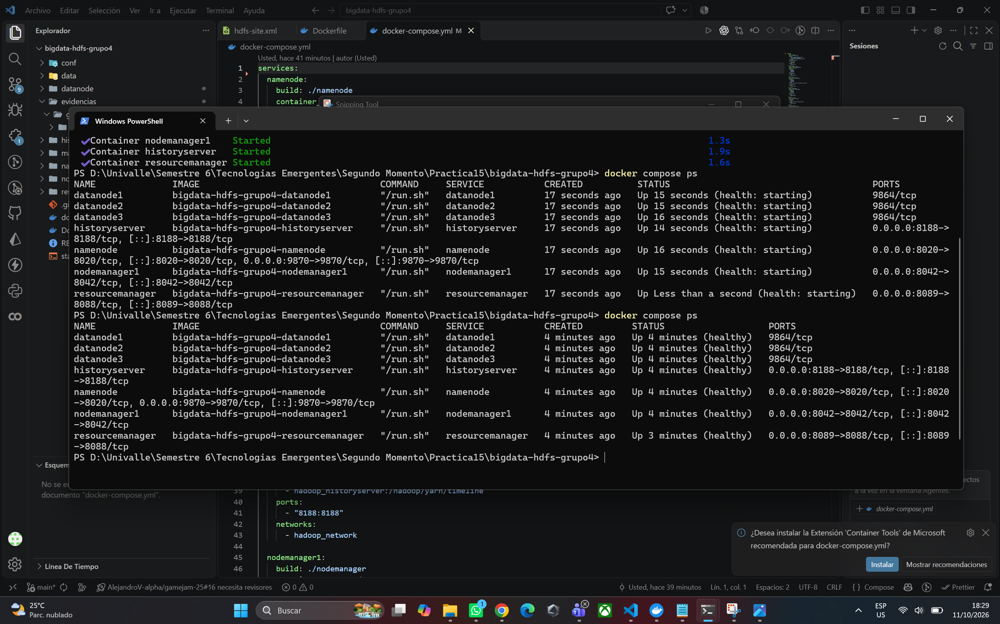

DataNodes activos reconocidos por HDFS:

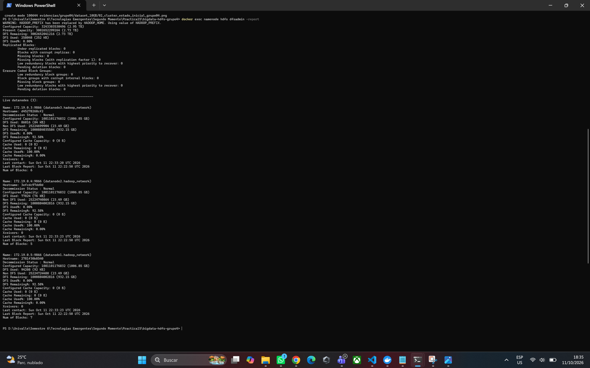

### 6.2 Distribucion de bloques y replicas

Se utilizó el directorio correspondiente al Grupo 4:

```text
/grupo04/dataset_10GB
```

Se verificó que HDFS estuviera configurado con un factor de replicación igual a `2` mediante:

```bash
docker exec namenode hdfs getconf -confKey dfs.replication
```

El comando devolvió:

```text
2
```

Posteriormente, se creó directamente en HDFS un dataset de 10 GB con el nombre:

```text
/grupo04/dataset_10GB/dataset_grupo04_10GB
```

El archivo fue generado mediante:

```bash
docker exec namenode sh -c 'dd if=/dev/zero bs=1M count=10240 2>/dev/null | hdfs dfs -put - /grupo04/dataset_10GB/dataset_grupo04_10GB'
```

Se comprobó su existencia y tamaño mediante:

```bash
docker exec namenode hdfs dfs -ls -h /grupo04/dataset_10GB
```

El resultado confirmó un tamaño de **10 GB** y un factor de replicación de **2**.

Para analizar la distribución de bloques y réplicas se utilizó:

```bash
docker exec namenode hdfs fsck /grupo04/dataset_10GB/dataset_grupo04_10GB -files -blocks -locations
```

El análisis mostró los siguientes resultados:

- Tamaño del archivo: **10 GB**
- Número total de bloques: **80**
- Tamaño promedio por bloque: **128 MB**
- Factor de replicación: **2**
- Promedio de replicación: **2.0**
- DataNodes activos: **3**
- Bloques subreplicados: **0**
- Bloques perdidos: **0**
- Bloques corruptos: **0**
- Estado del sistema de archivos: **HEALTHY**

Cada bloque del archivo posee dos réplicas distribuidas entre los tres DataNodes del clúster. Esto permite que el archivo continúe disponible aunque uno de los DataNodes falle.

#### Evidencias

Directorio HDFS correspondiente al Grupo 4:

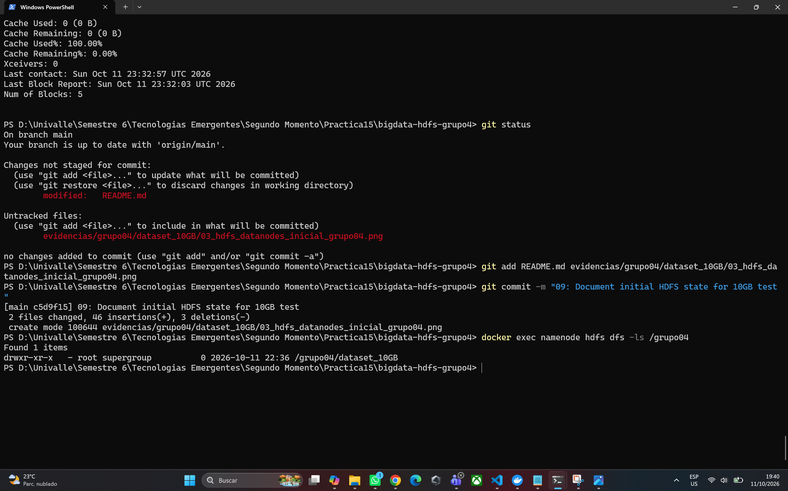

Factor de replicación configurado:

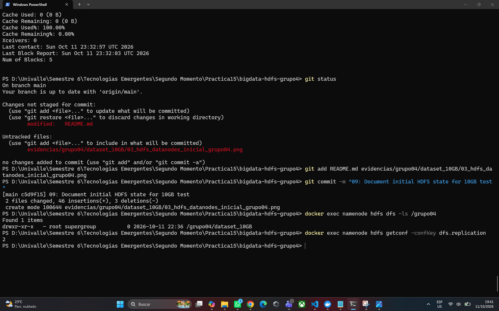

Dataset de 10 GB creado en HDFS:

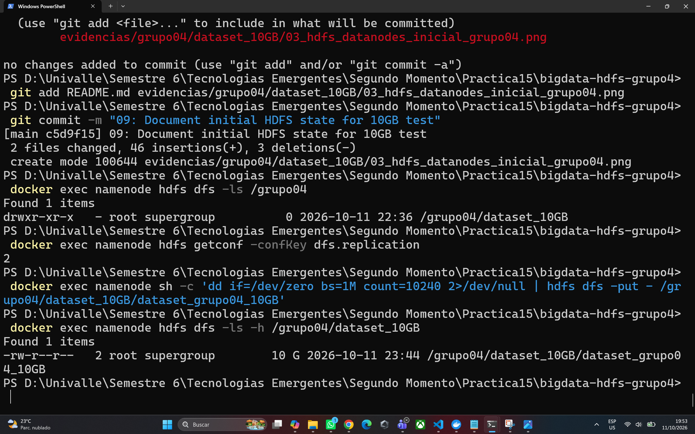

Distribución inicial de bloques y réplicas:

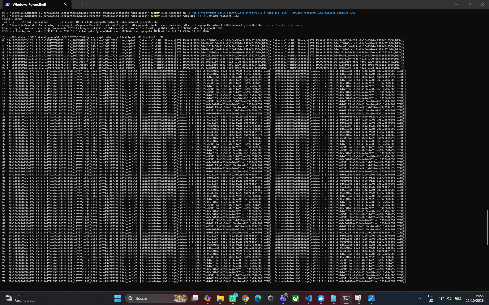

Resumen inicial de HDFS:


### 6.3 Falla del DataNode

Para simular una falla dentro del clúster se detuvo únicamente `datanode1`, manteniendo activos el NameNode, `datanode2` y `datanode3`.

Se utilizó el comando:

```bash
docker compose stop datanode1
```

Posteriormente, se verificó el estado de los contenedores mediante:

```bash
docker compose ps -a
```

El resultado mostró que `datanode1` se encontraba detenido, mientras que los otros dos DataNodes continuaban en estado `healthy`.

Después de esperar a que el NameNode detectara la ausencia de heartbeats del nodo detenido, se ejecutó:

```bash
docker exec namenode hdfs dfsadmin -report
```

HDFS reportó:

```text
Live datanodes (2)
Dead datanodes (1)
```

Esto confirmó que la caída de `datanode1` había sido detectada correctamente por HDFS.

#### Evidencias

DataNode1 detenido:

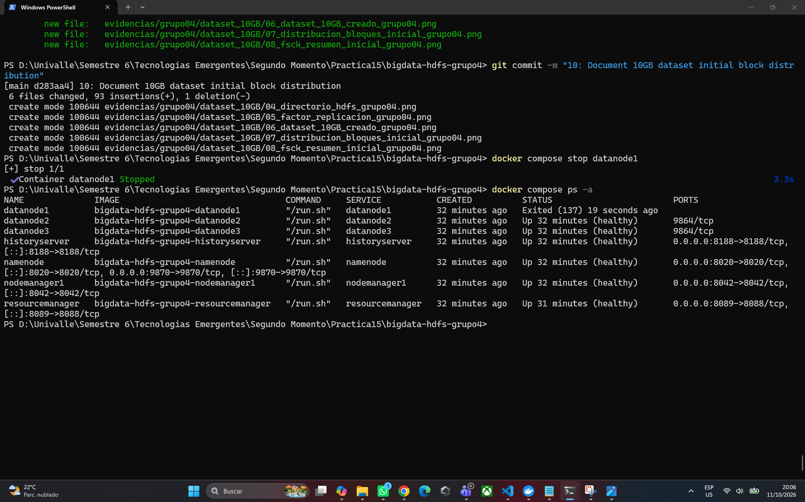

DataNode detectado como muerto por HDFS:

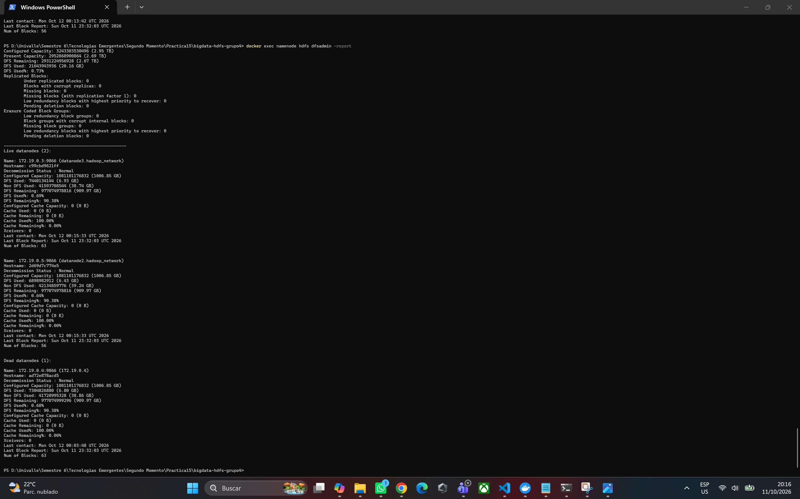

### 6.4 Estado durante la falla

Con `datanode1` detenido se volvió a ejecutar el análisis del dataset:

```bash
docker exec namenode hdfs fsck /grupo04/dataset_10GB/dataset_grupo04_10GB -files -blocks -locations
```

El resultado mostró:

- DataNodes activos: **2**
- Número total de bloques: **80**
- Bloques subreplicados: **50**
- Factor de replicación objetivo: **2**
- Promedio de replicación: **1.375**
- Réplicas faltantes: **50**
- Bloques perdidos: **0**
- Bloques corruptos: **0**
- Estado del archivo: **HEALTHY**

Los bloques afectados continuaban disponibles, pero 50 de ellos poseían temporalmente una sola réplica viva.

Por ejemplo, HDFS indicó para varios bloques:

```text
Target Replicas is 2 but found 1 live replica(s)
```

A pesar de esta situación, ningún bloque se perdió.

Para comprobar que el dataset seguía siendo accesible durante la falla se ejecutó:

```bash
docker exec namenode sh -c 'hdfs dfs -cat /grupo04/dataset_10GB/dataset_grupo04_10GB | wc -c'
```

El resultado fue:

```text
10737418240
```

Esto confirmó que los 10 GB del archivo pudieron ser leídos completamente aunque `datanode1` se encontrara detenido.

#### Evidencias

Bloques subreplicados durante la falla:

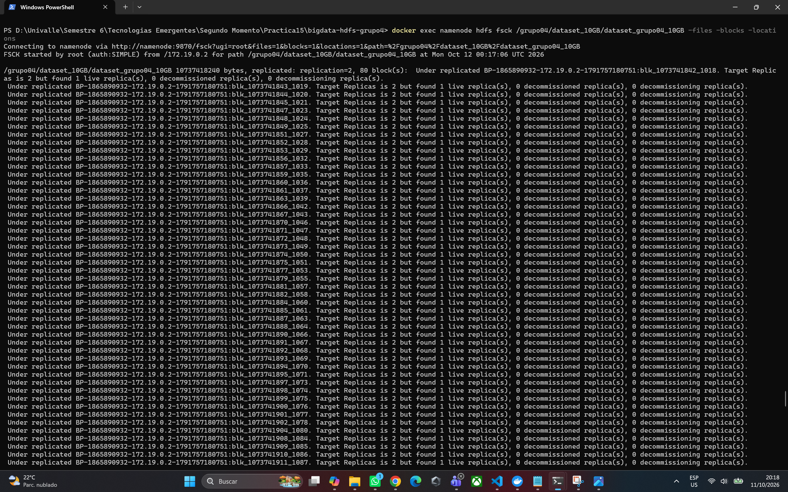

Resumen de FSCK durante la falla:

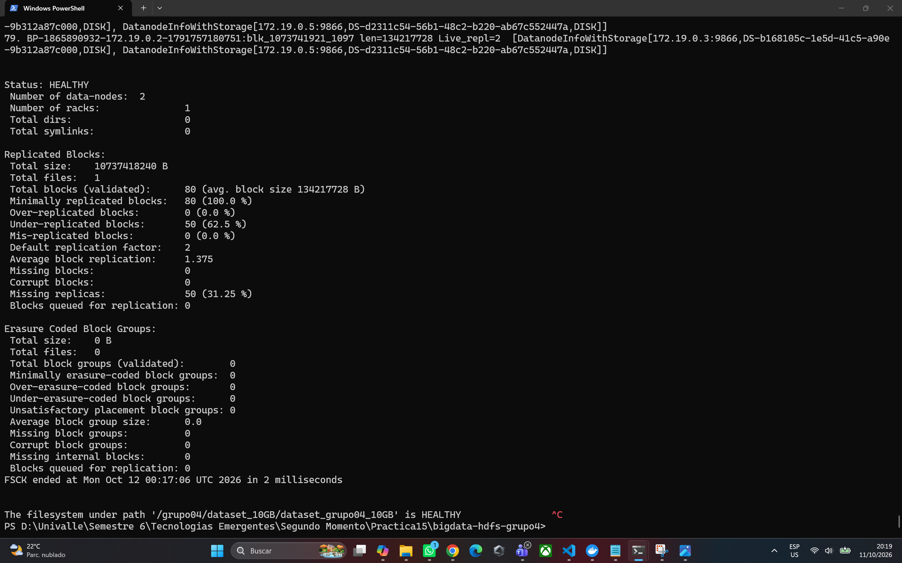

Dataset legible durante la falla:

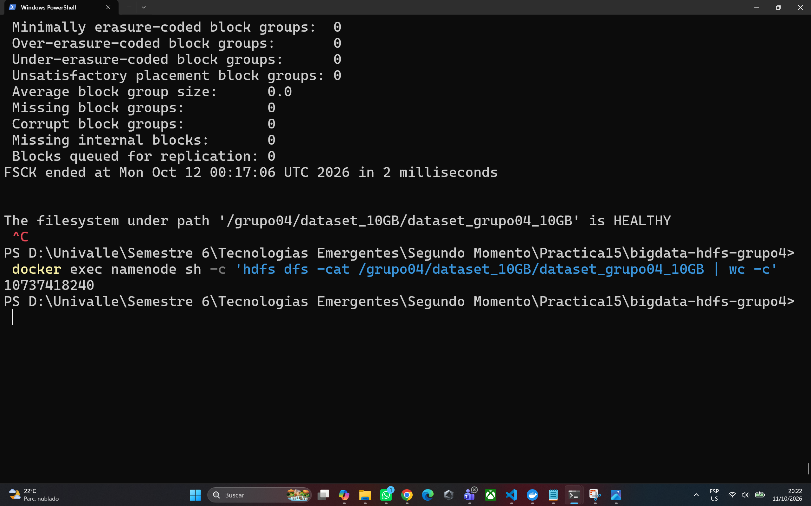

### 6.5 Recuperacion

Después de detectar la falla, HDFS inició automáticamente el proceso de recuperación de las réplicas faltantes utilizando los dos DataNodes que permanecían activos.

Se volvió a ejecutar:

```bash
docker exec namenode hdfs fsck /grupo04/dataset_10GB/dataset_grupo04_10GB -files -blocks -locations
```

En la primera medición durante la falla existían:

```text
Under-replicated blocks: 50
Average block replication: 1.375
Missing replicas: 50
```

Posteriormente, sin iniciar todavía `datanode1`, HDFS mostró:

```text
Under-replicated blocks: 0
Average block replication: 2.0
Missing replicas: 0
```

Esto demuestra que HDFS reconstruyó automáticamente las réplicas faltantes entre `datanode2` y `datanode3`, recuperando nuevamente el factor de replicación configurado en `2`.

La primera medición con bloques subreplicados se realizó aproximadamente a las `00:17:06 UTC`, mientras que a las `00:26:13 UTC` el proceso ya se encontraba finalizado.

Por lo tanto, la recuperación fue confirmada dentro de un intervalo de aproximadamente **9 minutos**, aunque no se registró el instante exacto en el que finalizó.

Después de comprobar la recuperación automática se restauró `datanode1` mediante:

```bash
docker compose start datanode1
```

Posteriormente, `docker compose ps` confirmó que el nodo volvió a estado `healthy`.

Finalmente, se verificó nuevamente el clúster:

```bash
docker exec namenode hdfs dfsadmin -report
```

El resultado volvió a mostrar:

```text
Live datanodes (3)
```

Al regresar al clúster, `datanode1` apareció inicialmente con `0` bloques. Esto ocurrió porque HDFS ya había reconstruido las réplicas necesarias en `datanode2` y `datanode3`, por lo que no necesitaba mover nuevamente los bloques al nodo recuperado para cumplir el factor de replicación.

#### Evidencias

Replicación recuperada automáticamente:

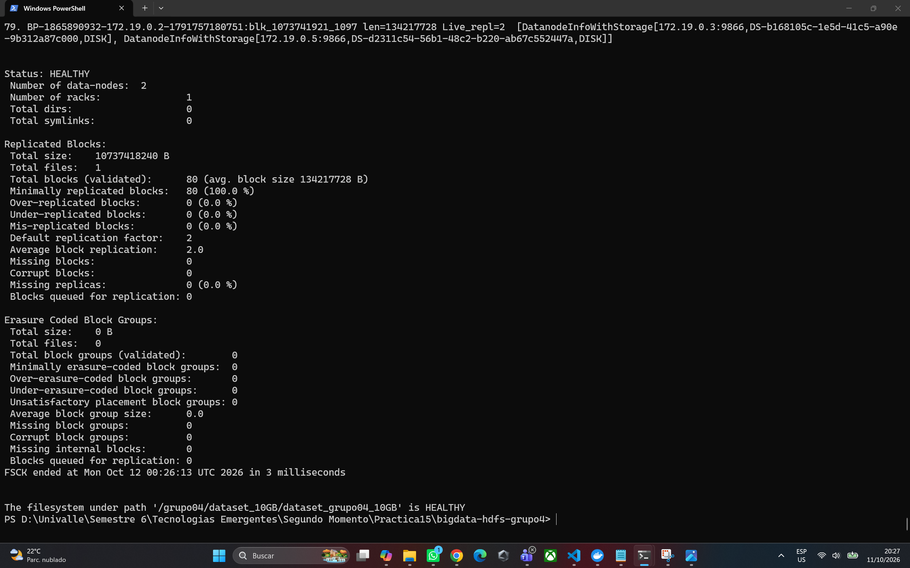

DataNode1 restaurado:

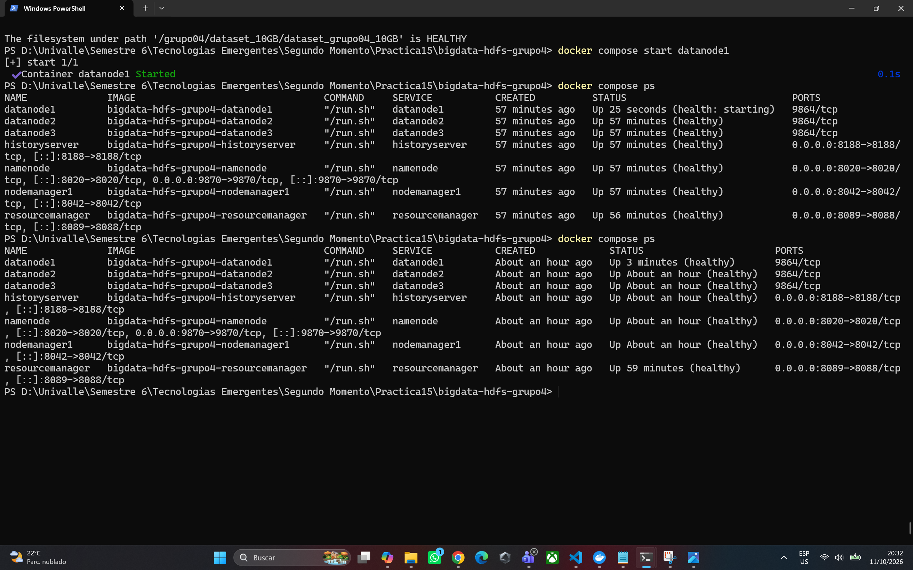

Tres DataNodes nuevamente activos:

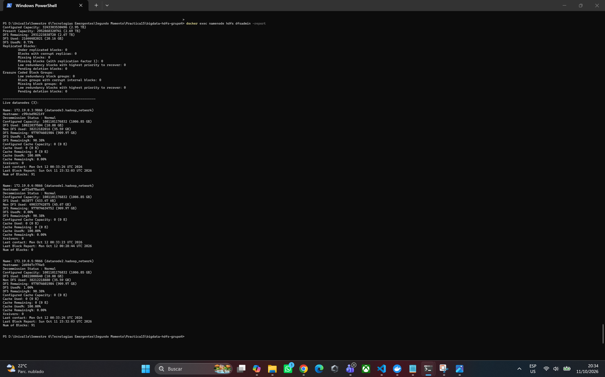

### 6.6 Analisis

La prueba permitió observar el funcionamiento de la tolerancia a fallos de HDFS sobre un dataset de 10 GB.

Antes de la falla, el archivo estaba dividido en **80 bloques de 128 MB**, cada uno con un factor de replicación de **2** y distribuido entre tres DataNodes.

Al detener `datanode1`, HDFS detectó posteriormente la pérdida del nodo y el clúster pasó de tres a dos DataNodes activos.

Como consecuencia, **50 de los 80 bloques quedaron temporalmente subreplicados**, debido a que una de sus dos copias se encontraba en el nodo detenido. Sin embargo:

- Ningún bloque se perdió.
- Ningún bloque quedó corrupto.
- El archivo continuó en estado `HEALTHY`.
- Los 10 GB del dataset pudieron seguir siendo leídos completamente.

Posteriormente, HDFS utilizó las copias disponibles en los DataNodes supervivientes para crear nuevas réplicas. De esta forma, los bloques subreplicados pasaron de **50 a 0** y el promedio de replicación regresó de **1.375 a 2.0**.

Cuando `datanode1` fue restaurado, HDFS volvió a reconocer tres DataNodes activos. Sin embargo, las réplicas del dataset ya habían sido reconstruidas en `datanode2` y `datanode3`, por lo que el nodo recuperado no necesitó recibir inmediatamente nuevamente los bloques.

La prueba demuestra que la replicación permite a HDFS mantener la disponibilidad de la información ante la falla de un DataNode y recuperar automáticamente el nivel de redundancia configurado.

#### Evidencia final

Estado final del dataset:

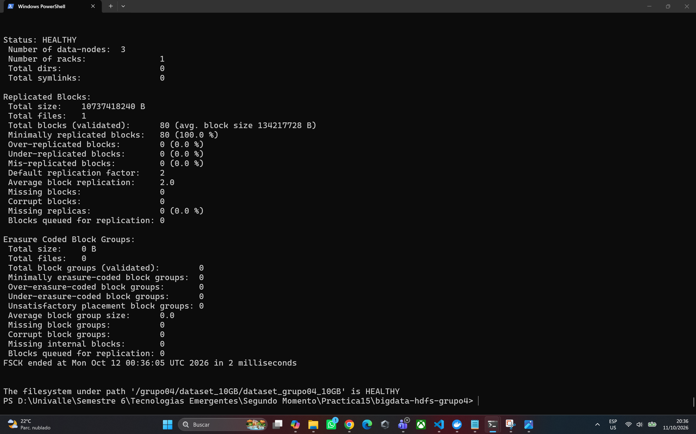

El estado final mostró:

- DataNodes activos: **3**
- Bloques totales: **80**
- Bloques subreplicados: **0**
- Factor de replicación: **2**
- Promedio de replicación: **2.0**
- Bloques perdidos: **0**
- Réplicas faltantes: **0**
- Estado: **HEALTHY**

## 7. Comparacion 1 GB vs 10 GB

Persona 2 y 3

| Característica                       | Dataset 1 GB        | Dataset 10 GB                                                               |
| ------------------------------------ | ------------------- | --------------------------------------------------------------------------- |
| Tamaño                               | 1 GB                | 10 GB                                                                       |
| Número de bloques                    | Pendiente Persona 2 | 80                                                                          |
| Factor de replicación                | Pendiente Persona 2 | 2                                                                           |
| DataNode afectado                    | Pendiente Persona 2 | datanode1                                                                   |
| Bloques afectados                    | Pendiente Persona 2 | 50                                                                          |
| Bloques disponibles después de falla | Pendiente Persona 2 | 80 de 80                                                                    |
| ¿Archivo accesible?                  | Pendiente Persona 2 | Sí                                                                          |
| ¿Existieron bloques subreplicados?   | Pendiente Persona 2 | Sí, 50                                                                      |
| Tiempo de recuperación               | Pendiente Persona 2 | Recuperación confirmada dentro de un intervalo de aproximadamente 9 minutos |
| Nuevas réplicas                      | Pendiente Persona 2 | Redistribuidas entre datanode2 y datanode3                                  |

## 8. Preguntas de analisis y exposicion

Personas 1, 2 y 3

### Pregunta 7

**¿Qué sucede con los bloques que tenían una réplica en el DataNode que falló?**

Cuando un DataNode falla, los bloques que tenían una réplica guardada en ese nodo pierden temporalmente una de sus copias y quedan subreplicados.

En nuestra prueba con el dataset de 10 GB, al detener `datanode1`, 50 de los 80 bloques quedaron con una sola réplica disponible. Aun así, el archivo se pudo seguir leyendo porque esos bloques todavía tenían otra copia en alguno de los DataNodes que seguían funcionando.

Después, HDFS detectó esa falta de réplicas y creó nuevas copias en los nodos disponibles hasta volver a cumplir el factor de replicación 2.

### Pregunta 8

**¿Quién administra la ubicación y replicación de los bloques: el cliente, el DataNode o el NameNode?**

El encargado es el `NameNode`.

El NameNode mantiene la información sobre qué bloques forman cada archivo, en qué DataNodes están guardados y cuántas réplicas existen de cada uno.

Los DataNodes son los que almacenan físicamente los bloques, pero las decisiones sobre su ubicación y replicación son administradas por el NameNode.

### Pregunta 9

**¿Qué diferencia existe entre disponibilidad del archivo y cumplimiento del factor de replicación después de una falla?**

La disponibilidad significa que el archivo todavía puede ser leído porque sigue existiendo al menos una copia disponible de cada bloque.

En cambio, cumplir el factor de replicación significa que cada bloque tiene la cantidad de copias configurada en HDFS.

En nuestra prueba, después de detener `datanode1`, el archivo seguía disponible, pero 50 bloques quedaron temporalmente con una sola réplica, aunque el factor configurado era 2.

Por eso un archivo puede seguir disponible aunque, durante un tiempo, no se esté cumpliendo completamente el factor de replicación.

## 9. Evidencias

Cada persona coloca las suyas.

## 10. Conclusion

Entre los tres.

## 11. Estructura del repositorio

Persona 1
